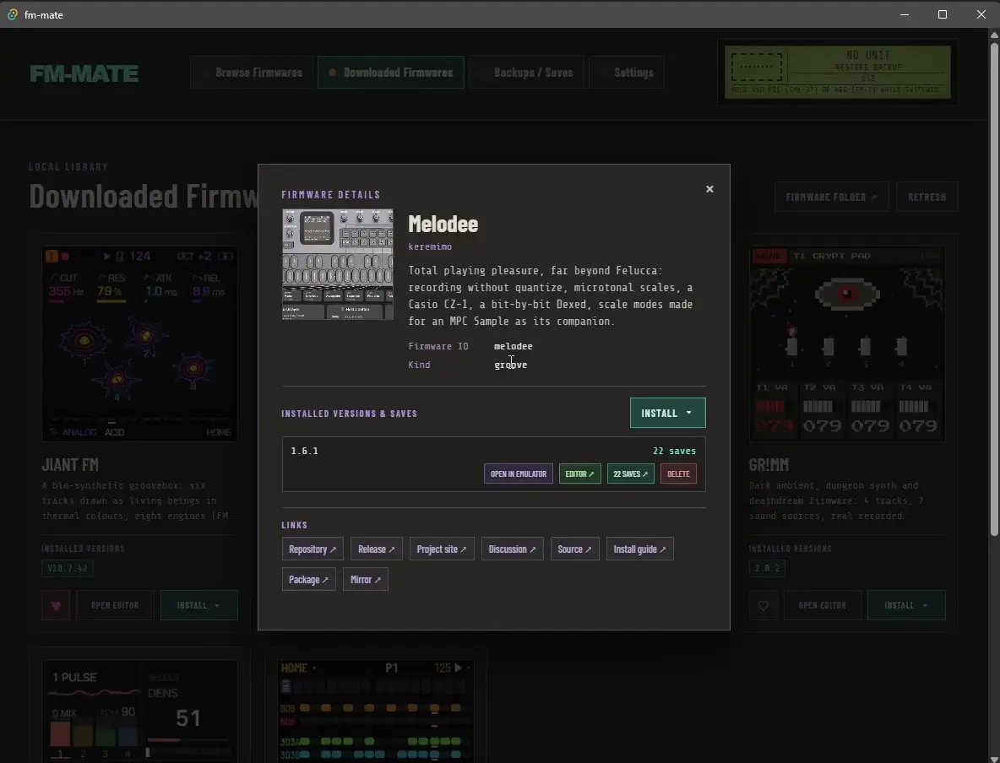

# FM-MATE

FM-MATE is a modern, user-friendly desktop application for managing FM-1 device firmwares with an intuitive app store-like experience. Download, flash, backup, and seamlessly switch between firmware versions—all offline!

## Demo



## Quick Install

Download the latest version for your platform:

- **[Windows MSI Installer](../../releases/latest)** - Windows x64
- **[macOS DMG](../../releases/latest)** - Apple Silicon (M1+)

Visit the [releases page](../../releases) to download the latest stable version.

## Features

- **Download Firmwares**: Browse and download firmware versions for your FM-1 device directly within the app
- **Flash Firmware**: Flash downloaded firmwares to your device with a single click
- **Backup & Save**: Create and manage backups of your device's current firmware and saves
- **Switch Versions**: Easily switch between different firmware versions you've downloaded
- **Try in Emulator**: Test firmware versions locally using FM1-Emu before installing them on your device
- **Emulator Support**: Open firmwares and saves directly in the emulator for safe experimentation
- **Offline Operation**: Manage your firmwares without requiring internet connectivity after initial downloads
- **Intuitive UI**: Beautiful, modern interface designed for ease of use
- **Cross-Platform**: Available for Windows and macOS

## Getting Started

### Prerequisites

- Node.js 20+ and npm
- Rust (for building from source)
- Tauri CLI

### Installation

1. Clone the repository:
   ```bash
   git clone https://github.com/yourusername/FM-MATE.git
   cd FM-MATE
   ```

2. Install dependencies:
   ```bash
   npm install
   ```

3. Run the development server:
   ```bash
   npm run dev
   ```

4. Build the application:
   ```bash
   npm run build
   ```

### Download Binaries

Pre-built binaries are available as artifacts from the [GitHub Actions workflows](../../actions). Visit the **Build** workflow to download the latest Windows MSI/NSIS installer or macOS DMG.

## Project Structure

```
FM-MATE/
├── src/                      # Frontend source code
│   ├── components/           # Vue components
│   ├── views/               # Page views
│   ├── services/            # Business logic services
│   ├── types/               # TypeScript type definitions
│   ├── App.vue              # Root component
│   └── main.ts              # Entry point
├── src-tauri/               # Tauri backend (Rust)
├── docs/                    # Documentation and assets
├── public/                  # Static assets
├── package.json             # Node.js dependencies
└── vite.config.ts          # Vite configuration
```

## Development

### Available Scripts

- `npm run dev` - Start development server with hot reload
- `npm run build` - Build the application for production
- `npm run preview` - Preview the production build locally
- `npm run tauri` - Run Tauri commands

### Tech Stack

- **Frontend**: Vue 3 with TypeScript
- **Build Tool**: Vite
- **Desktop Framework**: Tauri
- **Package Manager**: npm

### Recommended IDE Setup

- [VS Code](https://code.visualstudio.com/)
- [Vue - Official](https://marketplace.visualstudio.com/items?itemName=Vue.volar) extension
- [Tauri](https://marketplace.visualstudio.com/items?itemName=tauri-apps.tauri-vscode) extension
- [rust-analyzer](https://marketplace.visualstudio.com/items?itemName=rust-lang.rust-analyzer) extension

## Building

FM-MATE is built using GitHub Actions. The build workflow:

- Runs on every push and pull request
- Generates Windows x64 installers (MSI and NSIS)
- Generates macOS Apple Silicon DMG
- Uploads artifacts for download

**Note**: Builds are currently not code-signed or notarized.

## License

This project is licensed under the MIT License - see the LICENSE file for details.

## Contributing

Contributions are welcome! Please feel free to submit a Pull Request.

## Support

For issues, feature requests, or questions, please open an issue on the [GitHub repository](../../issues).

---

**Made with ❤️ using Tauri + Vue + TypeScript**
